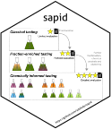

<!-- README.md is generated from README.qmd. Please edit that file -->

# sapid 

<!-- badges: start -->

[](https://lifecycle.r-lib.org/articles/stages.html#experimental)
[](https://github.com/adafede/sapid/actions/workflows/R-CMD-check.yaml)
[](https://app.codecov.io/gh/adafede/sapid)
[](https://adafede.r-universe.dev/sapid)
[](https://doi.org/10.5281/zenodo.14616395)
<!-- badges: end -->

A Strategy to Analyze Plant Extracts Taste in Depth (SAPID).

`sapid` integrates sensory panel data (free profiling, projective
napping, Chasselas model-wine modulation, and 3-AFC recognition
threshold testing) with untargeted LC-MS feature tables, Charged Aerosol
Detection (CAD) semi-quantification, taxonomically informed metabolite
annotations (TIMA), and 1D proton NMR spectral clustering. It
accompanies the study of *Swertia chirayita* bitter extracts published
in *Current Research in Food Science*
(<https://doi.org/10.1016/j.crfs.2025.101043>).

## Installation

Install `sapid` along with its CRAN, Bioconductor, and R-universe
dependencies:

``` r
if (!requireNamespace("BiocManager", quietly = TRUE)) {
  install.packages("BiocManager", repos = "https://cloud.r-project.org")
}
install.packages(
  "sapid",
  repos = c(
    "https://adafede.r-universe.dev",
    "https://taxonomicallyinformedannotation.r-universe.dev",
    BiocManager::repositories(),
    "https://cloud.r-project.org"
  )
)
```

## Quick Start

The bundled datasets let you run descriptor harmonization and panel
consistency filtering immediately after installation:

``` r
library(sapid)
#> Welcome to sapid
#> To cite sapid in publications use:  Rutz A (2026). _sapid: A Strategy to Analyze Plant Extracts Taste In
#>   Depth_. R package, version 0.0.0.9002.  Adriano Rutz; Pascale Deneulin; Ivano Tonutti; Benoit Bach and
#>   Jean-Luc Wolfender. (5 April 2025). SAPID: a Strategy to Analyze
#>   Plant Extracts Taste In Depth. Application to the complex taste of
#>   Swertia chirayita (Roxb.) H.Karst. Current Research in Food Science.
#>   doi:10.1016/j.crfs.2025.101043.To see these entries in BibTeX format, use 'format(<citation>,
#> bibtex=TRUE)', or 'toBibtex(.)'.

harmonize_terms(
  dictionary = dictionary_generic,
  x = c("amer", "acidité", "ferreux"),
  mode = "word"
)
#> [1] "BITTER"   "ACID"     "METALLIC"

consistent <- load_consistent_profiles(profiles, min_jury = 2L)
head(
  consistent[, c("fraction", "session", "jury", "taste_original", "taste", "value")],
  6L
)
#>      fraction    session    jury taste_original  taste value
#> 1 fraction_17 session_01 jury_08       AMERTUME BITTER   0.0
#> 2 fraction_17 session_01 jury_11           AMER BITTER   2.5
#> 3 fraction_17 session_01 jury_13   MINERAL AMER BITTER   3.8
#> 4 fraction_17 session_01 jury_16       AMERTUME BITTER   3.3
#> 5 fraction_18 session_01 jury_08       AMERTUME BITTER   4.7
#> 6 fraction_18 session_01 jury_11           AMER BITTER   2.4
```

## Package Scope and Data Requirements

`sapid` includes 10 datasets (`chasselas`, `concentration_afc`,
`dictionary_generic`, `dictionary_napping`, `dictionary_specific`,
`fractions`, `groups`, `napping_coordinates`, `napping_descriptors`,
`profiles`) and 24 exported functions. End-to-end LC-MS/CAD/NMR
ingestion functions require external raw files that are not bundled in
the installed package due to file size.

| Workflow stage | Exported functions | Required input |
|----|----|----|
| Term harmonization and filtering | `harmonize_terms()`, `harmonize_terms_df()`, `load_consistent_profiles()` | Bundled dictionaries and `profiles` (or user data frames) |
| Sensory and psychophysical visualization | `plot_profiles()` (sensory mode), `plot_napping()`, `plot_chasselas_variation()`, `plot_chasselas_modulation()`, `plot_concentration()`, `plot_descriptors_network()`, `plot_matrices()`, `geom_sigmoid()`, `sigmoid()` | Bundled datasets (`profiles`, `napping_*`, `chasselas`, `concentration_afc`, `fractions`) |
| Raw sensory spreadsheet import | `load_session()`, `get_session_info()`, `prepare_profiles()`, `prepare_napping()`, `prepare_chasselas()`, `prepare_concentration()`, `plot_informed_tasting()` | External tasting session `.xlsx`/TSV exports and fraction mass tables |
| LC-MS, CAD, and TIMA correlation | `prepare_chemical_profiles()`, `correlate_ion_taste_intensities()`, `plot_correlations()`, `plot_profiles()` (chemical/combined modes) | External MZmine `.csv`, `.mzML`, CAD peak lists, and TIMA annotations |
| 1D proton NMR clustering | `cluster_nmr()`, `plot_chromatograms()` | External 1D NMR directories (`AlpsNMR`) and chromatographic index tables |

## Documentation and Contributing

- Package website: <https://adafede.github.io/sapid/>
- Overview vignette: [Get started](vignettes/sapid.qmd)
- Workflow articles: [Sensory and
  psychophysics](vignettes/articles/I-sensory.qmd), [Chemical and
  correlations](vignettes/articles/II-correlations.qmd)
- Contributor workflow, local build/test instructions, and PR checks:
  [CONTRIBUTING.md](CONTRIBUTING.md)

## Main Citations

If you use `sapid` or its upstream metabolomics tools, please cite the
relevant publications and specific database versions used in your
analysis:

### SAPID

- Article: <https://doi.org/10.1016/j.crfs.2025.101043>

### mzmine

- <https://doi.org/10.1038/s41587-023-01690-2>

### SIRIUS

- General: <https://doi.org/10.1038/s41592-019-0344-8>
- *CSI:FingerId*: <https://doi.org/10.1073/pnas.1509788112>
- *ZODIAC*: <https://doi.org/10.1038/s42256-020-00234-6>
- *CANOPUS*: <https://doi.org/10.1038/s41587-020-0740-8>
- *COSMIC*: <https://doi.org/10.1038/s41587-021-01045-9>

### LOTUS

- General: <https://doi.org/10.7554/eLife.70780>
- Dataset record (cite the version used):
  <https://doi.org/10.5281/zenodo.5794106>

### ISDB

- General: <https://doi.org/10.1021/acs.analchem.5b04804>
- Dataset record (cite the version used):
  <https://doi.org/10.5281/zenodo.5607185>

### TIMA

- General: <https://doi.org/10.3389/fpls.2019.01329>
- Dataset record (cite the version used):
  <https://doi.org/10.5281/zenodo.5797920>

### Others

- NPClassifier: <https://doi.org/10.1021/acs.jnatprod.1c00399>

## Additional Software Credits

| Package | Version | Citation |
|:---|:---|:---|
| AlpsNMR | 4.14.0 | Madrid-Gambin et al. (2020) |
| base | 4.6.2 | R Core Team (2026) |
| BiocManager | 1.30.27 | Morgan and Ramos (2025) |
| BiocVersion | 3.23.1 | Morgan (2025) |
| cascade | 0.0.0.9003 | Rutz and Wolfender (2023); Rutz (2026a) |
| data.table | 1.18.6.1 | Barrett et al. (2026) |
| dendextend | 1.19.1 | Galili (2015) |
| FactoMineR | 2.18 | Lê et al. (2008) |
| ggpubr | 1.0.0 | Kassambara (2026) |
| ggraph | 2.2.2 | Pedersen (2025) |
| ggrepel | 0.9.8 | Slowikowski (2026) |
| igraph | 2.3.4 | Csárdi and Nepusz (2006); Antonov et al. (2023); Csárdi et al. (2026) |
| knitr | 1.52 | Xie (2014); Xie (2015); Xie (2026) |
| rmarkdown | 2.32 | Xie et al. (2018); Xie et al. (2020); Allaire et al. (2026) |
| sapid | 0.0.0.9002 | Rutz et al. (2025); Rutz (2026b) |
| SensoMineR | 1.28 | Husson et al. (2025) |
| tidyverse | 2.0.0 | Wickham et al. (2019) |
| tinytest | 1.4.3 | <span class="nocase">van der Loo</span> (2020) |
| treemapify | 2.6.1 | Wilkins (2026) |
| withr | 3.0.3 | Hester et al. (2026) |

<div id="refs" class="references csl-bib-body hanging-indent">

<div id="ref-rmarkdown2026" class="csl-entry">

Allaire, JJ, Yihui Xie, Christophe Dervieux, et al. 2026.
*<span class="nocase">rmarkdown</span>: Dynamic Documents for r*.
<https://github.com/rstudio/rmarkdown>.

</div>

<div id="ref-igraph2023" class="csl-entry">

Antonov, Michael, Gábor Csárdi, Szabolcs Horvát, et al. 2023. “Igraph
Enables Fast and Robust Network Analysis Across Programming Languages.”
*arXiv Preprint arXiv:2311.10260*, ahead of print.
<https://doi.org/10.48550/arXiv.2311.10260>.

</div>

<div id="ref-datatable" class="csl-entry">

Barrett, Tyson, Matt Dowle, Arun Srinivasan, et al. 2026.
*<span class="nocase">data.table</span>: Extension of
“<span class="nocase">data.frame</span>”*.
<https://doi.org/10.32614/CRAN.package.data.table>.

</div>

<div id="ref-igraph2006" class="csl-entry">

Csárdi, Gábor, and Tamás Nepusz. 2006. “The Igraph Software Package for
Complex Network Research.” *InterJournal* Complex Systems: 1695.
<https://igraph.org>.

</div>

<div id="ref-igraph2026" class="csl-entry">

Csárdi, Gábor, Tamás Nepusz, Vincent Traag, et al. 2026.
*<span class="nocase">igraph</span>: Network Analysis and Visualization
in r*. <https://doi.org/10.5281/zenodo.7682609>.

</div>

<div id="ref-dendextend" class="csl-entry">

Galili, Tal. 2015. “<span class="nocase">dendextend</span>: An r Package
for Visualizing, Adjusting, and Comparing Trees of Hierarchical
Clustering.” *Bioinformatics*, ahead of print.
<https://doi.org/10.1093/bioinformatics/btv428>.

</div>

<div id="ref-withr" class="csl-entry">

Hester, Jim, Lionel Henry, Kirill Müller, Kevin Ushey, Hadley Wickham,
and Winston Chang. 2026. *<span class="nocase">withr</span>: Run Code
“With” Temporarily Modified Global State*.
<https://doi.org/10.32614/CRAN.package.withr>.

</div>

<div id="ref-SensoMineR" class="csl-entry">

Husson, Francois, Sebastien Le, and Marine Cadoret. 2025. *SensoMineR:
Sensory Data Analysis*.
<https://doi.org/10.32614/CRAN.package.SensoMineR>.

</div>

<div id="ref-ggpubr" class="csl-entry">

Kassambara, Alboukadel. 2026. *<span class="nocase">ggpubr</span>:
“<span class="nocase">ggplot2</span>” Based Publication Ready Plots*.
<https://CRAN.R-project.org/package=ggpubr>.

</div>

<div id="ref-FactoMineR" class="csl-entry">

Lê, Sébastien, Julie Josse, and François Husson. 2008. “FactoMineR: A
Package for Multivariate Analysis.” *Journal of Statistical Software* 25
(1): 1–18. <https://doi.org/10.18637/jss.v025.i01>.

</div>

<div id="ref-AlpsNMR" class="csl-entry">

Madrid-Gambin, Francisco, Oller-Moreno, et al. 2020. “AlpsNMR: An r
Package for Signal Processing of Fully Untargeted NMR-Based
Metabolomics.” *Bioinformatics*, ahead of print, January.
<https://doi.org/10.1093/bioinformatics/btaa022>.

</div>

<div id="ref-BiocVersion" class="csl-entry">

Morgan, Martin. 2025. *BiocVersion: Set the Appropriate Version of
Bioconductor Packages*.

</div>

<div id="ref-BiocManager" class="csl-entry">

Morgan, Martin, and Marcel Ramos. 2025. *BiocManager: Access the
Bioconductor Project Package Repository*.
<https://doi.org/10.32614/CRAN.package.BiocManager>.

</div>

<div id="ref-ggraph" class="csl-entry">

Pedersen, Thomas Lin. 2025. *<span class="nocase">ggraph</span>: An
Implementation of Grammar of Graphics for Graphs and Networks*.
<https://doi.org/10.32614/CRAN.package.ggraph>.

</div>

<div id="ref-base" class="csl-entry">

R Core Team. 2026. *R: A Language and Environment for Statistical
Computing*. R Foundation for Statistical Computing.
<https://doi.org/10.32614/R.manuals>.

</div>

<div id="ref-cascade2026" class="csl-entry">

Rutz, Adriano. 2026a. *<span class="nocase">cascade</span>:
Contextualizing Untargeted Annotation with Semi-Quantitative Charged
Aerosol Detection for Pertinent Characterization of Natural Extracts*.

</div>

<div id="ref-sapid2026" class="csl-entry">

Rutz, Adriano. 2026b. *<span class="nocase">sapid</span>: A Strategy to
Analyze Plant Extracts Taste in Depth*.

</div>

<div id="ref-sapid2025" class="csl-entry">

Rutz, Adriano, Pascale Deneulin, Ivano Tonutti, Benoit Bach, and
Jean-Luc Wolfender. 2025. “SAPID: A Strategy to Analyze Plant Extracts
Taste in Depth. Application to the Complex Taste of Swertia Chirayita
(Roxb.) h.karst.” *Current Research in Food Science*, ahead of print.
<https://doi.org/10.1016/j.crfs.2025.101043>.

</div>

<div id="ref-cascade2023" class="csl-entry">

Rutz, Adriano, and Jean-Luc Wolfender. 2023. “Automated Composition
Assessment of Natural Extracts: Untargeted Mass Spectrometry-Based
Metabolite Profiling Integrating Semiquantitative Detection.” *Journal
of Agricultural and Food Chemistry* 71 (46).
<https://doi.org/10.1021/acs.jafc.3c03099>.

</div>

<div id="ref-ggrepel" class="csl-entry">

Slowikowski, Kamil. 2026. *<span class="nocase">ggrepel</span>:
Automatically Position Non-Overlapping Text Labels with
“<span class="nocase">ggplot2</span>”*.
<https://doi.org/10.32614/CRAN.package.ggrepel>.

</div>

<div id="ref-tinytest" class="csl-entry">

<span class="nocase">van der Loo, MPJ</span>. 2020. “A Method for
Deriving Information from Running r Code.” *The R Journal* 13: 42–52.
<https://journal.r-project.org/articles/RJ-2021-056/>.

</div>

<div id="ref-tidyverse" class="csl-entry">

Wickham, Hadley, Mara Averick, Jennifer Bryan, et al. 2019. “Welcome to
the <span class="nocase">tidyverse</span>.” *Journal of Open Source
Software* 4 (43): 1686. <https://doi.org/10.21105/joss.01686>.

</div>

<div id="ref-treemapify" class="csl-entry">

Wilkins, David. 2026. *<span class="nocase">treemapify</span>: Draw
Treemaps in “<span class="nocase">ggplot2</span>”*.
<https://doi.org/10.32614/CRAN.package.treemapify>.

</div>

<div id="ref-knitr2014" class="csl-entry">

Xie, Yihui. 2014. “<span class="nocase">knitr</span>: A Comprehensive
Tool for Reproducible Research in R.” In *Implementing Reproducible
Computational Research*, edited by Victoria Stodden, Friedrich Leisch,
and Roger D. Peng. Chapman; Hall/CRC.

</div>

<div id="ref-knitr2015" class="csl-entry">

Xie, Yihui. 2015. *Dynamic Documents with R and Knitr*. 2nd ed. Chapman;
Hall/CRC. <https://yihui.org/knitr/>.

</div>

<div id="ref-knitr2026" class="csl-entry">

Xie, Yihui. 2026. *<span class="nocase">knitr</span>: A General-Purpose
Package for Dynamic Report Generation in R*. <https://yihui.org/knitr/>.

</div>

<div id="ref-rmarkdown2018" class="csl-entry">

Xie, Yihui, J. J. Allaire, and Garrett Grolemund. 2018. *R Markdown: The
Definitive Guide*. Chapman; Hall/CRC.
<https://pkg.yihui.org/rmarkdown-book/>.

</div>

<div id="ref-rmarkdown2020" class="csl-entry">

Xie, Yihui, Christophe Dervieux, and Emily Riederer. 2020. *R Markdown
Cookbook*. Chapman; Hall/CRC.
<https://pkg.yihui.org/rmarkdown-cookbook/>.

</div>

</div>
