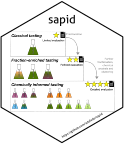

---
format:
  gfm: default
  html: default
bibliography: grateful-refs.bib
---

<!-- README.md is generated from README.qmd. Please edit that file -->

```{r}
#| label: knitr
#| include: false

knitr::opts_chunk$set(
  collapse = TRUE,
  comment = "#>",
  fig.path = "man/figures/README-",
  out.width = "100%"
)
```

# sapid 

<!-- badges: start -->
[](https://lifecycle.r-lib.org/articles/stages.html#experimental)
[](https://github.com/adafede/sapid/actions/workflows/R-CMD-check.yaml)
[](https://app.codecov.io/gh/adafede/sapid)
[](https://adafede.r-universe.dev/sapid)
[](https://doi.org/10.5281/zenodo.14616395)
<!-- badges: end -->

A Strategy to Analyze Plant Extracts Taste in Depth (SAPID).

`sapid` integrates sensory panel data (free profiling, projective napping, Chasselas model-wine modulation, and 3-AFC recognition threshold testing) with untargeted LC-MS feature tables, Charged Aerosol Detection (CAD) semi-quantification, taxonomically informed metabolite annotations (TIMA), and 1D proton NMR spectral clustering. It accompanies the study of *Swertia chirayita* bitter extracts published in *Current Research in Food Science* (<https://doi.org/10.1016/j.crfs.2025.101043>).

## Installation

Install `sapid` and its GitHub and Bioconductor dependencies from R-universe:

```r
install.packages(
  "sapid",
  repos = c(
    "https://adafede.r-universe.dev",
    "https://taxonomicallyinformedannotation.r-universe.dev",
    "https://cran.r-universe.dev",
    "https://bioc.r-universe.dev"
  )
)
```

## Quick Start

The bundled datasets let you run descriptor harmonization and panel consistency filtering immediately after installation:

```{r}
#| label: quickstart

library(sapid)

harmonize_terms(
  dictionary = dictionary_generic,
  x = c("amer", "acidité", "ferreux"),
  mode = "word"
)

consistent <- load_consistent_profiles(profiles, min_jury = 2L)
head(
  consistent[, c("fraction", "session", "jury", "taste_original", "taste", "value")],
  6L
)
```

## Package Scope and Data Requirements

`sapid` includes 10 datasets (`chasselas`, `concentration_afc`, `dictionary_generic`, `dictionary_napping`, `dictionary_specific`, `fractions`, `groups`, `napping_coordinates`, `napping_descriptors`, `profiles`) and 24 exported functions. End-to-end LC-MS/CAD/NMR ingestion functions require external raw files that are not bundled in the installed package due to file size.

| Workflow stage | Exported functions | Required input |
| --- | --- | --- |
| Term harmonization and filtering | `harmonize_terms()`, `harmonize_terms_df()`, `load_consistent_profiles()` | Bundled dictionaries and `profiles` (or user data frames) |
| Sensory and psychophysical visualization | `plot_profiles()` (sensory mode), `plot_napping()`, `plot_chasselas_variation()`, `plot_chasselas_modulation()`, `plot_concentration()`, `plot_descriptors_network()`, `plot_matrices()`, `geom_sigmoid()`, `sigmoid()` | Bundled datasets (`profiles`, `napping_*`, `chasselas`, `concentration_afc`, `fractions`) |
| Raw sensory spreadsheet import | `load_session()`, `get_session_info()`, `prepare_profiles()`, `prepare_napping()`, `prepare_chasselas()`, `prepare_concentration()`, `plot_informed_tasting()` | External tasting session `.xlsx`/TSV exports and fraction mass tables |
| LC-MS, CAD, and TIMA correlation | `prepare_chemical_profiles()`, `correlate_ion_taste_intensities()`, `plot_correlations()`, `plot_profiles()` (chemical/combined modes) | External MZmine `.csv`, `.mzML`, CAD peak lists, and TIMA annotations |
| 1D proton NMR clustering | `cluster_nmr()`, `plot_chromatograms()` | External 1D NMR directories (`AlpsNMR`) and chromatographic index tables |

## Documentation and Contributing

- Package website: <https://adafede.github.io/sapid/>
- Overview vignette: [Get started](vignettes/sapid.qmd)
- Workflow articles: [Sensory and psychophysics](vignettes/articles/I-sensory.qmd), [Chemical and correlations](vignettes/articles/II-correlations.qmd)
- Contributor workflow, local build/test instructions, and PR checks: [CONTRIBUTING.md](CONTRIBUTING.md)

## Main Citations

If you use `sapid` or its upstream metabolomics tools, please cite the relevant publications and specific database versions used in your analysis:

### SAPID

- Article: <https://doi.org/10.1016/j.crfs.2025.101043>

### mzmine

- <https://doi.org/10.1038/s41587-023-01690-2>

### SIRIUS

- General: <https://doi.org/10.1038/s41592-019-0344-8>
- *CSI:FingerId*: <https://doi.org/10.1073/pnas.1509788112>
- *ZODIAC*: <https://doi.org/10.1038/s42256-020-00234-6>
- *CANOPUS*: <https://doi.org/10.1038/s41587-020-0740-8>
- *COSMIC*: <https://doi.org/10.1038/s41587-021-01045-9>

### LOTUS

- General: <https://doi.org/10.7554/eLife.70780>
- Dataset record (cite the version used): <https://doi.org/10.5281/zenodo.5794106>

### ISDB

- General: <https://doi.org/10.1021/acs.analchem.5b04804>
- Dataset record (cite the version used): <https://doi.org/10.5281/zenodo.5607185>

### TIMA

- General: <https://doi.org/10.3389/fpls.2019.01329>
- Dataset record (cite the version used): <https://doi.org/10.5281/zenodo.5797920>

### Others

- NPClassifier: <https://doi.org/10.1021/acs.jnatprod.1c00399>

## Additional Software Credits

```{r}
#| label: grateful
#| echo: false
#| message: false

# altdoc renders from docs/ or vignettes/, so look up DESCRIPTION relative to cwd
desc_path <- if (file.exists("DESCRIPTION")) {
  "."
} else {
  ".."
}
grateful::cite_packages(
  output = "table",
  out.dir = getwd(),
  path = desc_path
) |>
  knitr::kable()
```
